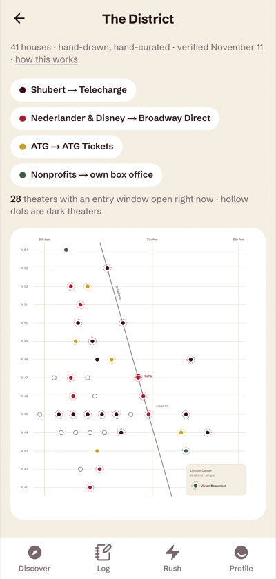

# Matinee

[](https://github.com/CharlieNey/matinee/actions/workflows/ci.yml)
[](https://github.com/CharlieNey/matinee/actions/workflows/production-health.yml)

**The live board for Broadway rush, lotteries and cheap seats, with a show
diary.** Live at **[matinee.nyc](https://matinee.nyc)**.

Broadway runs dozens of official ways in for $10 to $60: digital lotteries,
box-office rush, student rush, standing room, the TKTS booth. They live on
half a dozen platforms and box offices, and open and close at odd hours. Matinee puts
them on one board with live countdowns in New York time, tells you which
official seller each show uses, and links out to it. It never sells tickets.

Matinee began in July 2026 as a design study of the Theatr iOS app, a
face-value ticket resale app I use, and grew into its own product around a
different problem: curated rush/lottery programs, official-ticketer clarity,
and the TKTS board. It has no marketplace. Every purchase deep-links out to
the official seller; Matinee is the index, never the checkout. (The study's
reference screenshots are Theatr's copyrighted material and are not
distributed with this repo.)

## Screenshots

Phone layout. A desktop layout is one toggle away on wide screens.

<p>
  
  
  
  
</p>

## What's in it

| Route | Screen |
|---|---|
| `/` | Discover: the running catalog, each card answering "cheapest way in" ("Lottery **$40**"), with circuit, rush-and-lottery, on-TKTS-today and cheapest filters |
| `/rush` | Rush & Lottery: every program grouped by open now, later today and coming up, with live countdowns and deep links to the entry pages |
| `/shows/[slug]` | A show as an answer sheet: official seller with an all-in fee estimate, every way to save with claim windows, today's TKTS row, and Follow for deadline pushes |
| `/district` | Every Broadway house on one map, colored by owner and ticketing platform, with live halos where a window is open |
| `/trip` | Trip mode: a day-by-day plan of rush, lottery and TKTS moves for a visit |
| `/notify` | Shows you follow and the deadline-push opt-in |
| `/profile` | Diary timeline, lottery record (entries, wins, saved vs face value) and collection |
| `/log/[slug]` | Log a show: date, seat, sentiment, thoughts, tags, photo |
| `/wrapped` | A shareable season recap from the diary and lottery log |
| `/about` | Why the data is hand-curated, who sells which theater, open data endpoints |

## How it works

**[docs/ARCHITECTURE.md](docs/ARCHITECTURE.md)** is the five-minute version:
data model, how program windows are computed, storage, push, CI and the hourly
production health check, and what was deliberately not built.

In one paragraph: there is no API for any of this, so shows, programs and the
41 theaters are curated TypeScript data (`src/lib/shows.ts`,
`src/lib/programs.ts`, `src/lib/theaters.ts`) with a verification date on every
row. A pure schedule engine turns each program's weekly windows into
"open, closes in 23 min" in New York time. Personal data (diary, follows,
lottery log) stays in versioned browser storage; there are no accounts.
Supabase holds only push subscriptions. GitHub Actions runs the push evaluator
every 15 minutes and calls `/api/health` hourly, which fails if any program
row is more than 14 days unverified.

Stack: Next.js 16 (App Router), React 19, TypeScript, Tailwind v4, Motion,
Supabase, `web-push`, Vercel, Vitest, Playwright. `DESIGN.md` is the design
system; `PLAN.md` is the product log, phase by phase.

## What was hard

- **No single source of truth for Broadway tickets.** Ticketing splits by
  theater owner and most of it has no public API, so the catalog is curated by
  hand and the app tells you where each show's official box office is.
  Background in `RESEARCH.md` and `DATA.md`.
- **Programs that open and close on schedules.** A lottery can open at
  midnight and close a day later; Hamilton's runs Friday to Thursday; a rush
  line ends when tickets run out. The engine models weekly windows with day
  offsets in New York wall-clock time, correct across daylight saving.
- **Stale data is the failure mode.** Every program carries a verified date. A
  row that can't be re-confirmed keeps its old date and reads as unverified,
  and `/api/health` turns the hourly check red.
- **A local-first diary that never loses data.** Entries live in versioned
  `localStorage`, photos in IndexedDB, with validated import and export.
  Unreadable storage is backed up rather than overwritten.
- **Static pages under a strict CSP.** A static Content-Security-Policy plus
  Subresource Integrity keeps every page statically rendered and cacheable.

## Running it

```bash
npm install
npm run dev        # http://localhost:3000
npm run check      # lint + types + unit tests + production build
npm run test:e2e   # Playwright journeys; run `npm run build` first
```

Push notifications need the Supabase and VAPID settings in `.env.example`
(setup below). To reset local
state, use Profile → Settings, or clear the `matinee-state-v1` and
`matinee-lottery-log-v1` keys in `localStorage` and the `matinee-diary`
IndexedDB database.

## Quality and operations

- **CI** (`.github/workflows/ci.yml`): lint, TypeScript, Vitest (schedule
  engine, data integrity, persistence, TKTS parsing, the health endpoint),
  `npm audit`, production build, Playwright in Chromium and WebKit, and an axe
  accessibility scan.
- **Production health** (`production-health.yml`): hourly `GET /api/health`,
  which returns 503 if the database or TKTS is down or any program is more than
  14 days unverified.
- **Data refresh**: re-check each program against the show's own site and TDF,
  update the row and its `lastVerified`, and leave the old date on anything
  you couldn't confirm. `npm test` catches broken slugs, duplicate programs,
  bad times and programs left on closed shows.

## Deadline pushes: setup

1. Create a Supabase project and run `supabase/migrations/` in filename order.
2. Copy `.env.example` to `.env.local` and fill it in (`npx web-push
   generate-vapid-keys` for the key pair). Set the same variables in Vercel.
3. Add `APP_URL` (the deployed origin) and `CRON_SECRET` as GitHub Actions
   secrets so `notify-cron.yml` can call the evaluator.
4. Smoke test: turn alerts on at `/notify`, use **Send a test push**, then
   `curl -X POST -H "Authorization: Bearer $CRON_SECRET" <origin>/api/notify/run`
   and read the JSON summary (events, sends, dedupes, pruned endpoints).

iOS delivers web push only after Add to Home Screen (16.4+). The desktop,
installed-iPhone and backup-recording steps are in
[`docs/notification-demo.md`](docs/notification-demo.md).

## Poster art

`public/posters/` holds key art from the shows' official sites and Playbill
covers (`src/lib/posters.json` maps slug to file). Next Image serves AVIF/WebP
variants; shows without art get a generated typographic tile.

> ⚠️ The poster images are copyrighted marketing material, included as
> non-commercial portfolio reference with attribution. They are **not**
> covered by this repo's MIT license (see LICENSE). Replace or license them
> before any commercial use; takedown requests are honored immediately.

## License

Code and original documentation are [MIT](LICENSE). Poster artwork and show
marketing assets are **not**; they belong to their productions and are
included only as non-commercial portfolio reference (see the scope note in
LICENSE and the colophon on [/about](https://matinee.nyc/about)).
