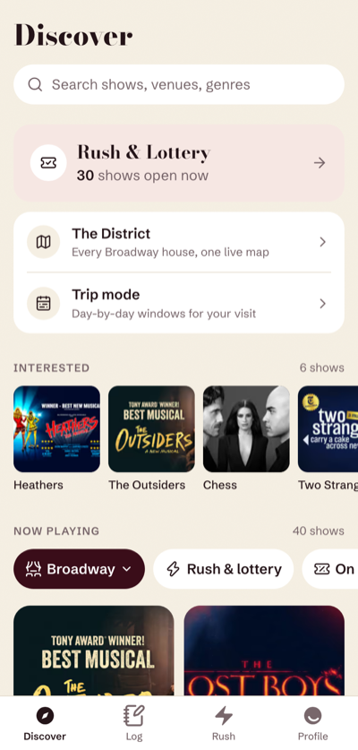
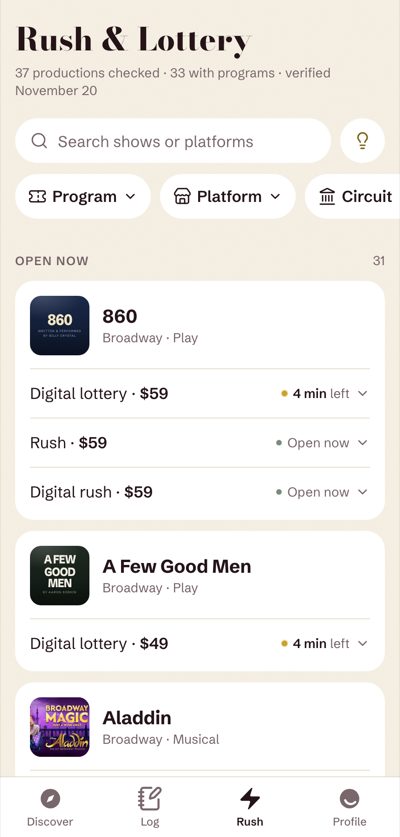
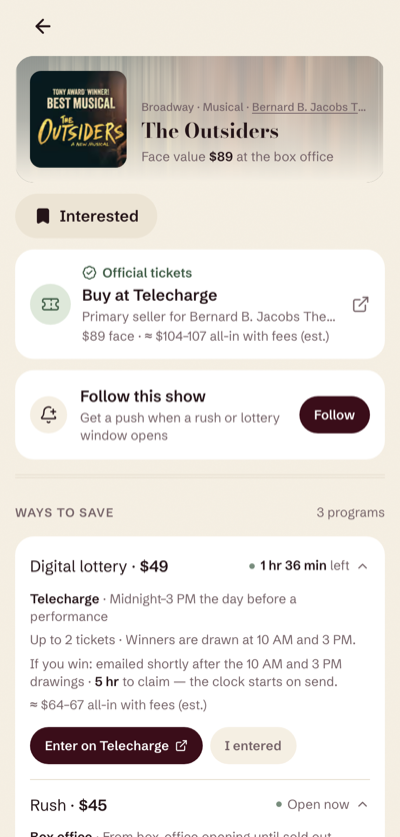

# Matinee

[](https://github.com/CharlieNey/matinee/actions/workflows/ci.yml)
[](https://github.com/CharlieNey/matinee/actions/workflows/production-health.yml)

**The live board for Broadway rush, lotteries and cheap seats, with a push
before each window opens and a show diary.** Live at
**[matinee.nyc](https://matinee.nyc)**.

Broadway runs dozens of official ways in for $10 to $60: digital lotteries,
box-office rush, student rush, standing room, the TKTS booth. They live on
half a dozen platforms and box offices, and open and close at odd hours. Matinee puts
them on one board with live countdowns in New York time, tells you which
official seller each show uses, and links out to it. It never sells tickets.

Matinee began in July 2026 as a UI clone of the Theatr iOS app, built from
screenshots to learn how the app was designed. Within two days I removed the
resale marketplace and rebuilt it around a different problem: a curated, live
board of rush, lottery and cheap-seat programs that links out to official
sellers. The original design language is still visible in `DESIGN.md`; the
product is not the same. (The reference screenshots are Theatr's copyrighted
material and are not distributed with this repo.)

## Screenshots

Phone layout. A desktop layout is one toggle away on wide screens.

<p>
  
  
  
  
</p>

## What's in it

| Route | Screen |
|---|---|
| `/` | Discover: the running catalog, each card answering "cheapest way in" ("Lottery **$40**"), with circuit, rush-and-lottery, on-TKTS-today and cheapest filters |
| `/rush` | Rush & Lottery: every program grouped by open now, later today and coming up, with live countdowns and deep links to the entry pages |
| `/shows/[slug]` | A show as an answer sheet: official seller with an all-in fee estimate, every way to save with claim windows, today's TKTS row, and Follow for deadline pushes |
| `/district` | Every Broadway house on one map, colored by owner and ticketing platform, with live halos where a window is open |
| `/trip` | Trip mode: a day-by-day plan of rush, lottery and TKTS moves for a visit |
| `/notify` | Shows you follow, alerts on or off for this device, and a test push that sends the next real alert |
| `/profile` | Diary timeline, lottery record (entries, wins, saved vs face value) and collection |
| `/log/[slug]` | Log a show: date, seat, sentiment, thoughts, tags, photo |
| `/wrapped` | A shareable season recap from the diary and lottery log |
| `/about` | Why the data is hand-curated, who sells which theater, open data endpoints |

## How it works

**[docs/ARCHITECTURE.md](docs/ARCHITECTURE.md)** is the five-minute version:
data model, how program windows are computed, storage, push, CI and the hourly
production health check, and what was deliberately not built.

In one paragraph: there is no API for any of this, so shows, programs and the
41 theaters are curated TypeScript data (`src/lib/shows.ts`,
`src/lib/programCatalog.ts`, `src/lib/theaters.ts`) with a verification date on every
row. A pure schedule engine turns each program's weekly windows into
"open, closes in 23 min" in New York time. Personal data (diary, follows,
lottery log) stays in versioned browser storage; there are no accounts.
Supabase holds only push state: subscriptions, a delivery ledger and a run
heartbeat. Supabase Cron calls the push evaluator every minute, and GitHub
Actions calls `/api/health` hourly, which fails if any program row is more
than 14 days unverified or the push scheduler has stopped.

Stack: Next.js 16 (App Router), React 19, TypeScript, Tailwind v4, Motion,
Supabase, `web-push`, Vercel, Vitest, Playwright. `DESIGN.md` is the design
system; `PLAN.md` is the product log, phase by phase.

## Notifications

Follow a show and Matinee pushes to that device 5 minutes before its rush
opens, when its lottery opens (at 8 AM if it opened overnight), and an hour
before the lottery closes. A tap lands on the show's ways to save. The spec,
written before the build, is [docs/NOTIFICATIONS.md](docs/NOTIFICATIONS.md).

> **Chicago rush opens at 10:00 AM**
> $49 at the box office, first come, first served.

What makes it more than a cron loop:

- **One push per device per alert, under retries.** Deciding what is due is a
  pure function of the clock and the catalog. Each alert has a send window,
  so a late run catches up ("rush opened at 10:00 AM") and a run after the
  window sends nothing. Sending is claim-then-send against a Postgres ledger:
  a run inserts `(endpoint, alert)` as claimed before it sends, and the
  primary key lets exactly one run win, so a doubled, late or overlapping
  scheduler cannot double-send.
- **Failures are classified, not retried blindly.** A 429, 5xx or network
  error releases the claim for the next minute. 404/410 prune the
  subscription. A run that dies mid-send leaves a 5-minute lease for the next
  run to take over. The repeat that can cause carries the same notification
  tag and Web Push `Topic`, so the phone replaces the first copy instead of
  showing two.
- **A scheduler that can't silently die.** GitHub disabled the original
  Actions cron after 60 days without a commit, and the health check stayed
  green for two months. The primary scheduler is now Supabase Cron, every
  minute. It is free, already provisioned, and not tied to repo activity, and
  it can only fail when the database push needs is down anyway. Eight options
  are compared in the spec.
- **Health that tells the truth.** Every run writes a heartbeat.
  `/api/health` returns 503 when no run has succeeded for 20 minutes, or when
  the rate limiter that protects `/api/push` doesn't answer.
- **Written for a lock screen.** The show comes first. Times are clock times,
  never countdowns. There are quiet hours from 10 PM to 8 AM. A TTL means an
  offline phone never gets a stale alert. The test push sends the exact next
  real alert for a show you follow.

Every database step is a Postgres function. One contract suite runs against
the in-memory store and against the real migrations in PGlite, and the
delivery engine is tested with an injected clock (double runs, overlap,
catch-up, staleness, retries, crash recovery). A local run with real Chrome
and Google's push service is recorded in [docs/notifications/](docs/notifications/).

## What was hard

- **No single source of truth for Broadway tickets.** Ticketing splits by
  theater owner and most of it has no public API, so the catalog is curated by
  hand and the app tells you where each show's official box office is.
  Background in `RESEARCH.md` and `DATA.md`.
- **Programs that open and close on schedules.** A lottery can open at
  midnight and close a day later; Hamilton's runs Friday to Thursday; a rush
  line ends when tickets run out. The engine models weekly windows with day
  offsets in New York wall-clock time, correct across daylight saving.
- **Exactly one push, from a scheduler that can fail.** See Notifications
  above: a claim ledger, a lease, and idempotent display.
- **Stale data is the failure mode.** Every program carries a verified date. A
  row that can't be re-confirmed keeps its old date and reads as unverified,
  and `/api/health` turns the hourly check red.
- **A local-first diary that never loses data.** Entries live in versioned
  `localStorage`, photos in IndexedDB, with validated import and export.
  Unreadable storage is backed up rather than overwritten.
- **Static pages under a strict CSP.** A static Content-Security-Policy plus
  Subresource Integrity keeps every page statically rendered and cacheable.

## Running it

```bash
npm install
npm run dev        # http://localhost:3000
npm run check      # lint + types + unit tests + production build
npm run test:e2e   # Playwright journeys; run `npm run build` first
```

Push notifications need VAPID keys and a store (setup below). To try them
without Supabase, run with `PUSH_STORE=memory` and local VAPID keys: the store
lives in the dev server's process. To reset local
state, use Profile → Settings, or clear the `matinee-state-v1` and
`matinee-lottery-log-v1` keys in `localStorage` and the `matinee-diary`
IndexedDB database.

## Quality and operations

- **CI** (`.github/workflows/ci.yml`): lint, TypeScript, Vitest (schedule
  engine, data integrity, persistence, TKTS parsing, the health endpoint),
  `npm audit`, production build, Playwright in Chromium and WebKit, and an axe
  accessibility scan.
- **Production health** (`production-health.yml`): hourly `GET /api/health`,
  which returns 503 if the database, rate limiter or TKTS is down, the push
  scheduler has not succeeded in 20 minutes, or any program is more than 14
  days unverified. The failing run prints which one.
- **Data refresh**: re-check each program against the show's own site and TDF,
  update the row and its `lastVerified`, and leave the old date on anything
  you couldn't confirm. `npm test` catches broken slugs, duplicate programs,
  bad times and programs left on closed shows.

## Deadline pushes: setup

1. Create a Supabase project and run `supabase/migrations/` in filename order.
2. Copy `.env.example` to `.env.local` and fill it in (`npx web-push
   generate-vapid-keys` for the key pair). Set the same variables in Vercel.
3. Turn on the scheduler: fill in and run `supabase/scheduler/enable.sql` in
   the Supabase SQL editor (`disable.sql` undoes it). Optionally keep the
   GitHub backup by adding `APP_URL` and `CRON_SECRET` as Actions secrets.
4. Smoke test: turn alerts on at `/notify`, use **Send a test push**, then
   `curl -X POST -H "Authorization: Bearer $CRON_SECRET" <origin>/api/notify/run`
   and read the JSON summary (events, pairs, sent, deduped, released,
   pruned). `/api/health` shows the last run and the last push.

iOS delivers web push only after Add to Home Screen (16.4+). The desktop,
installed-iPhone and backup-recording steps are in
[`docs/notification-demo.md`](docs/notification-demo.md).

## Poster art

`public/posters/` holds key art from the shows' official sites
(`src/lib/posters.json` maps slug to file). Next Image serves AVIF/WebP
variants; shows without art get a generated typographic tile. No Playbill
covers are used: the two that were (Operation Mincemeat, Ragtime) were
replaced by the generated tile in November 2026.

> ⚠️ The poster images are copyrighted marketing material, included as
> non-commercial portfolio reference with attribution. They are **not**
> covered by this repo's MIT license (see LICENSE). Replace or license them
> before any commercial use; takedown requests are honored immediately.

## License

Code and original documentation are [MIT](LICENSE). Poster artwork and show
marketing assets are **not**; they belong to their productions and are
included only as non-commercial portfolio reference (see the scope note in
LICENSE and the colophon on [/about](https://matinee.nyc/about)).
